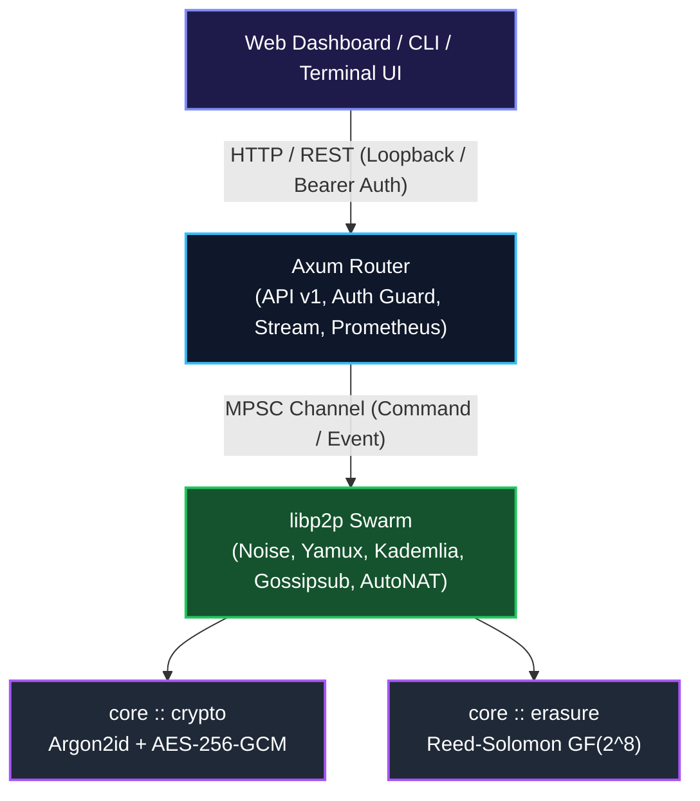
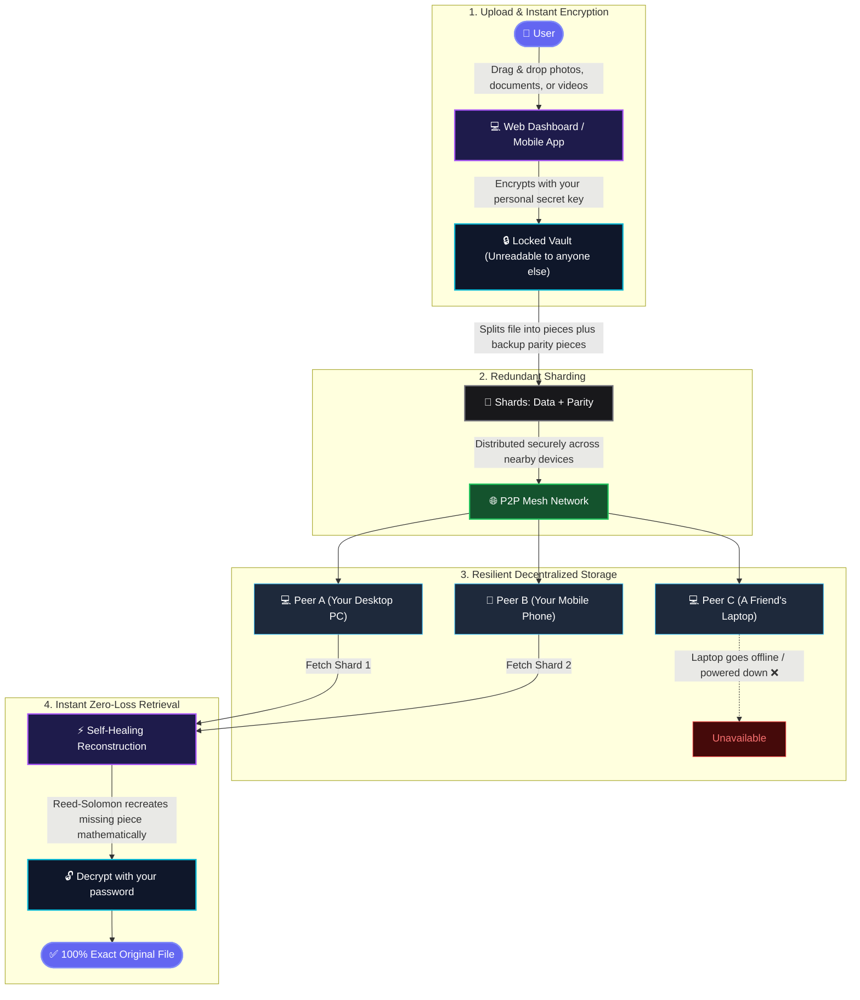
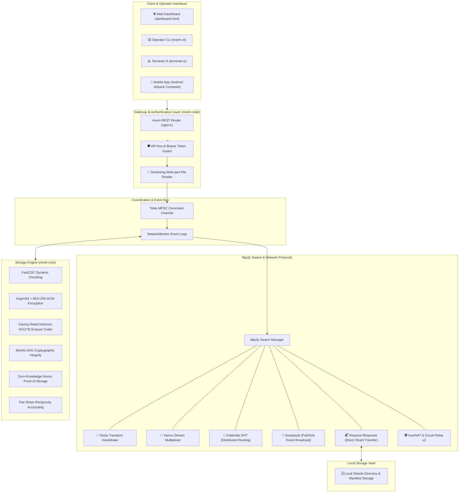
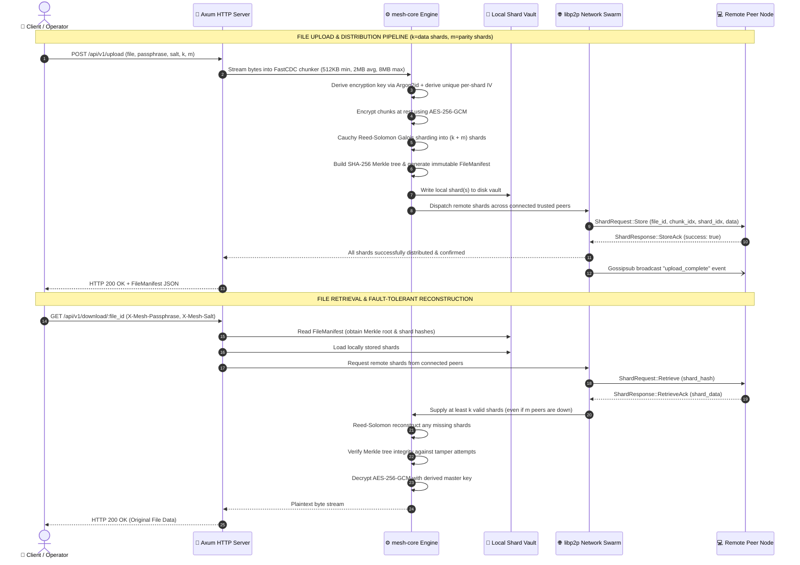

# Mesh-Storage-Monitor

> **Decentralized Peer-to-Peer Encrypted Mesh Storage Network & Visual Monitor**

A secure, decentralized, peer-to-peer storage network designed for local and global mesh topologies with zero central coordinator. Every peer is cryptographic equals. Files are partitioned via Content-Defined Chunking (FastCDC), protected through Reed-Solomon Galois field erasure coding, encrypted at-rest using AES-256-GCM with deterministic IV derivation, and distributed across authenticated peers via `libp2p`.

---

## Architecture Overview



---

## User Journey & Workflow (For Everyday Users)

How does Mesh Storage work for regular people without requiring cloud subscriptions or central servers?



---

## Architecture Workflow

The complete end-to-end component interaction flow, from client interfaces to the underlying cryptographic storage engine:



---

## Storage & Retrieval Pipeline

Detailed chronological sequence of cryptographic processing, distributed transport, and self-healing reconstruction:



---

## Technical Stack Hierarchy

Layered architectural map of all technologies, protocols, algorithms, and system integrations:

```mermaid
flowchart TB
    subgraph L1 ["1. Application & User Interface Layer"]
        direction LR
        L1A["Web UI: HTML5, CSS3 Glassmorphism, QR.js, Lucide Icons"]
        L1B["CLI: Clap v4, Tokio, Indicatif Streaming Progress"]
        L1C["Terminal UI: Crossterm, Ratatui Live Monitoring"]
        L1D["Android: Kotlin, Jetpack Compose, JNI Native Bridge"]
    end

    subgraph L2 ["2. Network & Transport Layer (libp2p)"]
        direction LR
        L2A["Transport: TCP, Noise Protocol Handshake, Yamux Multiplexing"]
        L2B["Discovery: mDNS (Local LAN), Kademlia DHT (Global WAN)"]
        L2C["Protocols: Request-Response (Shards), Gossipsub v1.1 Events"]
        L2D["Traversal: AutoNAT Identification, Circuit Relay v2"]
    end

    subgraph L3 ["3. Storage & Security Engine (mesh-core)"]
        direction LR
        L3A["Chunking: FastCDC Rolling Hash (512KB min, 2MB avg, 8MB max)"]
        L3B["Crypto: AES-256-GCM, Argon2id KDF, HKDF-SHA256 Derivation"]
        L3C["Erasure Coding: Cauchy Reed-Solomon GF(2^8) Engine"]
        L3D["Integrity: Merkle Tree (SHA-256 Root Hash Verification)"]
    end

    subgraph L4 ["4. Reliability, Economics & Governance"]
        direction LR
        L4A["Auditing: Zero-Knowledge Nonce Proof-of-Storage Challenges"]
        L4B["Fair-Share Economics: 4-Tier Reciprocity Credit Ledger"]
        L4C["Sybil Defense: /24 Subnet Density Clustering Guards"]
        L4D["Disaster Recovery: Authenticated .mbak Poly1305 Archives"]
    end

    subgraph L5 ["5. Platform & Systems Infrastructure"]
        direction LR
        L5A["Core Language: Rust 1.80+ (Memory-Safe, Fearless Concurrency)"]
        L5B["Database: PostgreSQL (ACID Control Plane, Schema Migrations)"]
        L5C["Target OS: Windows 11/10, Linux, macOS, Android (ARM64/x86)"]
    end

    L1 --> L2
    L2 --> L3
    L3 --> L4
    L4 --> L5
```



---

## Live Quick Start (Windows Launcher & Dashboard)

For immediate local or LAN deployment on Windows, execute [`launch.bat`](file:///c:/Users/adity/OneDrive/Desktop/p2p%20network/launch.bat):

1. **Double-click `launch.bat`** (or run `.\launch.bat` in PowerShell/CMD).
2. **Select `[1]`** to start the primary Anchor Node on port `4001` (HTTP API `3000`) and automatically open the visual dashboard in your browser (`http://localhost:3000/`).
3. **Select `[2]`** in a second terminal to spawn a secondary peer node on port `4002` (HTTP API `3001`).
4. **Scan & Join from Any Mobile Device**: Click the **"Scan & Join"** button in the dashboard header to generate live QR codes for:
   - Direct Web URL: `http://<LAN_IP>:3000/`
   - P2P Swarm Multiaddress: `/ip4/<LAN_IP>/tcp/4001/p2p/<PEER_ID>`
   - Signed Cryptographic Invitations for zero-trust mutual authentication.

For the comprehensive multi-device step-by-step physical manual, see [`LAUNCH_GUIDE.md`](file:///c:/Users/adity/OneDrive/Desktop/p2p%20network/LAUNCH_GUIDE.md).

---

### System Crates & Components

1. **[`/core`](file:///c:/Users/adity/OneDrive/Desktop/p2p%20network/core)**: Pure Rust storage engine with zero network dependencies:
   * **FastCDC**: Rolling-hash Content-Defined Chunking (512KB min, 2MB target average, 8MB max) with bounded memory streaming.
   * **Reed-Solomon Erasure Coding**: Cauchy matrix sharding over $GF(2^8)$ ($k$ data + $m$ parity shards).
   * **Deterministic AES-256-GCM + Argon2id**: Unique per-shard IV expansion (`derive_shard_iv`) preventing Merkle root (CID) mutation upon shard healing.
   * **Merkle DAG Verification**: Cryptographic chunk- and file-level integrity validation.
   * **Proof-of-Storage Auditing**: Nonce-challenge cryptographic proof verification preventing falsified capacity claims.
   * **Automated Shard Self-Repair**: Zero-knowledge deterministic reconstruction of degraded chunks.
   * **Reciprocity Credits & Sybil Defense**: 4-tier reciprocity accounting (Standard, Preferred, Throttled, Suspended) and `/24` subnet density limits.
   * **Disaster Recovery Backup**: Authenticated `.mbak` backup generation with Poly1305 tags and zeroized secret buffers.
2. **[`/node`](file:///c:/Users/adity/OneDrive/Desktop/p2p%20network/node)**: Canonical P2P daemon and REST gateway:
   * **Security-First API**: Binds to `127.0.0.1:3000` by default; auto-generates ephemeral API keys with security banners when exposed to non-loopback interfaces; enforces mandatory `MESH_API_KEY` outside local development.
   * **Axum REST API v1**: Complete status, peer allowlist pairing, upload, download, quotas, bandwidth limits, invites, pause/resume, and DR backup.
   * **Query-Passphrase Hardening**: Rejects passphrases in query parameters (`HTTP 400`) to prevent credential leakage in HTTP logs and history.
   * **libp2p Swarm Integration**: Noise encryption, Yamux multiplexing, Kademlia DHT, Gossipsub pub/sub, mDNS local discovery, Relay v2, and AutoNAT.
   * **Embedded Web UI**: Serves `dashboard.html` on `GET /` and `GET /dashboard`.
3. **[`/control-plane`](file:///c:/Users/adity/OneDrive/Desktop/p2p%20network/control-plane)**: SaaS multi-tenant authority:
   * **Bearer JWT Authentication**: Cryptographically validated JWTs (`Authorization: Bearer <TOKEN>`) with signature, algorithm (`HS256`), issuer, audience, and zero-leeway expiration checks.
   * **Anti-Spoofing Guard**: Directly supplied `x-oidc-*` headers from public clients are strictly rejected unless accompanied by an authorized internal gateway secret.
   * **Dual Storage Backend**:
     - **Production SaaS (`PostgresRepository`)**: Connects via `DATABASE_URL` with automatic SQL schema migrations, database-level unique constraints (`uq_tenants_slug`, `uq_tenant_peer`), and row-level locking (`FOR UPDATE`) for single-use invite consumption.
     - **Local Persistent Prototype (`FilePersistentRepository`)**: Disk-backed atomic JSON snapshots labeled explicitly for single-process local development.
4. **[`/mesh-cli`](file:///c:/Users/adity/OneDrive/Desktop/p2p%20network/mesh-cli)**: Operator command-line client:
   * Commands: `status`, `peers`, `invite`, `upload`, `download`, `quota`, `bandwidth`, `credits`, `repair-check`, `backup`, `metrics`, `pause`, `resume`, `leave`.
   * Asynchronous file streaming for upload and download without memory bloat.
5. **[`/terminal-ui`](file:///c:/Users/adity/OneDrive/Desktop/p2p%20network/terminal-ui)**: High-performance live ANSI terminal dashboard with once-mode support for CI/CD runners.
6. **[`/android`](file:///c:/Users/adity/OneDrive/Desktop/p2p%20network/android) & [`/android-bridge`](file:///c:/Users/adity/OneDrive/Desktop/p2p%20network/android-bridge)**: Native Android Kotlin/Compose integration:
   * JNI foreign function interface wrapping the pure Rust storage core.
   * Configured `cargo-ndk` build pipeline for `arm64-v8a`, `armeabi-v7a`, and `x86_64` ABIs with Gradle `jniLibs` packaging and instrumentation tests.
7. **[`/node_version`](file:///c:/Users/adity/OneDrive/Desktop/p2p%20network/node_version)**: Audited reference JavaScript implementation (0 npm vulnerabilities).

---

## Directory Layout

```
├── core/                       # Pure logic Rust storage engine (crypto, erasure, merkle, credits, backup)
├── node/                       # Canonical libp2p daemon & hardened Axum REST API server
├── control-plane/              # SaaS multi-tenant control plane (Bearer JWT, PostgreSQL, migrations)
├── mesh-cli/                   # Operator CLI client with async streaming upload/download
├── terminal-ui/                # Real-time ANSI terminal telemetry dashboard
├── android-bridge/             # JNI C-ABI bridge for Android Kotlin integration
├── android/                    # Android application shell (Kotlin / Jetpack Compose)
├── node_version/               # Audited legacy Node reference core (0 CVEs)
├── dashboard.html              # Dark glassmorphic web monitoring interface
├── RELEASE_CHECKLIST.md        # Quality gates, verification statuses, and production readiness checklist
├── RUN_TESTS.md                # Comprehensive test and execution guide
├── Cargo.toml                  # Cargo workspace manifest
└── Cargo.lock
```

---

## Security & Authentication Model

### 1. Loopback-First API & Mandatory Authentication
* By default, the node API binds strictly to **`127.0.0.1:3000`**.
* To expose the node across a LAN or server interface, supply `--bind 0.0.0.0` or `-b <IP>`.
* In LAN or production environments, `MESH_API_KEY` is **mandatory**. Requests without a matching `X-Mesh-Api-Key` or `Authorization: Bearer <KEY>` are rejected with `401 Unauthorized`.
* If bound outside loopback without `MESH_API_KEY`, the daemon generates an ephemeral cryptographic key and logs an alert banner.

### 2. Elimination of Query-String Passphrases
* Passing passphrases in query parameters (`GET /download/:file_id?passphrase=...`) is strictly rejected with `HTTP 400 Bad Request`.
* Passphrases must be supplied via **request body** (`POST /api/v1/download/:file_id`) or **headers** (`X-Mesh-Passphrase`, `X-Mesh-Salt`).

### 3. OIDC / SaaS Identity Authenticity
* The SaaS control plane does not trust client-supplied identity headers (`x-oidc-sub`, `x-oidc-tenant`).
* All requests require a signed Bearer token (`Authorization: Bearer <JWT>`) with HMAC-SHA256 signature verification, issuer/audience validation, and zero leeway on expiration.

---

## REST API Reference

Every node runs an Axum HTTP server (default: `http://127.0.0.1:3000`).

### Node Status & Peers
* **`GET /api/v1/status`**: Returns local peer ID, listen multiaddresses, connected peers, storage quota, and stored shard list.
* **`GET /api/v1/peers`**: Returns list of connected and trusted peer IDs.
* **`POST /api/v1/pair`**: Exchanges multiaddresses and establishes mutual trust via Noise handshake.
  ```json
  { "multiaddr": "/ip4/192.168.1.15/tcp/4001/p2p/12D3KooW..." }
  ```

### Storage Operations
* **`POST /api/v1/upload`**: Uploads and distributes a file across the mesh.
  * Form fields: `file_id`, `passphrase`, `salt`, `k` (data shards), `m` (parity shards), `file` (binary payload).
  * Returns: Content manifest with Merkle tree root and shard placement.
* **`POST /api/v1/download/:file_id`**: Downloads and reconstructs a file using request body credentials:
  ```json
  {
    "passphrase": "correct-horse-battery",
    "salt": "mysalt123",
    "k": 2,
    "m": 1
  }
  ```
* **`GET /api/v1/download/:file_id`**: Downloads using secure HTTP headers (`X-Mesh-Passphrase`, `X-Mesh-Salt`).

### Node Governance & Administration
* **`GET|POST /api/v1/quota`**: Queries or updates node storage quota.
* **`GET|POST /api/v1/bandwidth`**: Queries or sets rate limit (KB/s).
* **`POST /api/v1/invite/create`**: Generates a cryptographically signed node invitation token.
* **`POST /api/v1/invite/join`**: Consumes an invitation token to join a cluster.
* **`POST /api/v1/pause` & `POST /api/v1/resume`**: Pauses/resumes shard transfers and downloads.
* **`POST /api/v1/leave`**: Gracefully drains local shards and disconnects from the mesh.

### Observability, Auditing & DR
* **`GET /metrics`** or **`GET /api/v1/metrics`**: Exposes Prometheus text format metrics for scrape targets.
* **`GET /api/v1/credits/me`**: Returns reciprocity credit ledger and fair-share ratio.
* **`GET /api/v1/reliability/:peer_id`**: Returns peer reliability score and audit history.
* **`POST /api/v1/backup/export`**: Exports encrypted `.mbak` disaster recovery snapshot.
* **`POST /api/v1/backup/restore`**: Restores state and manifests from encrypted `.mbak` archive.

---

## Quality Gates & Verification Status

| Gate / Component | Target | Current Status | Note |
| :--- | :--- | :--- | :--- |
| **Workspace Test Suite** | 100% pass | **PASS (120/120 tests)** | All 6 workspace crates verified green |
| **Compiler & Clippy** | `-D warnings` | **PASS (0 warnings)** | Clean across all crates and targets |
| **Formatting** | `cargo fmt` | **PASS** | 0 formatting diffs |
| **Legacy Node Tests** | Node reference | **PASS (4/4 tests)** | Bit-for-bit parity and recovery tests pass |
| **Legacy Dependencies** | 0 audit CVEs | **PASS (0 CVEs)** | Upgraded Multer and express dependencies |
| **CI Automation** | GitHub Actions | **CI-configured** | Matrix configured; remote runner execution pending |
| **Control Plane DB** | PostgreSQL | **PASS (PostgreSQL)** | Schema migrations, ACID locking, unique constraints |
| **API Authentication** | Non-loopback | **PASS (Hardened)** | Ephemeral keys, loopback default, Bearer/Key guards |
| **Android Packaging** | NDK & Gradle | **PASS (Configured)** | `cargo-ndk` build script & jniLibs configured |
| **Production Clearance**| Full signoff | **NOT YET PASSED** | Physical 3-device LAN & WAN proofs pending |

For complete verification instructions and commands, refer to [`RUN_TESTS.md`](file:///c:/Users/adity/OneDrive/Desktop/p2p%20network/RUN_TESTS.md).  
For the detailed gate tracking matrix, refer to [`RELEASE_CHECKLIST.md`](file:///c:/Users/adity/OneDrive/Desktop/p2p%20network/RELEASE_CHECKLIST.md).
